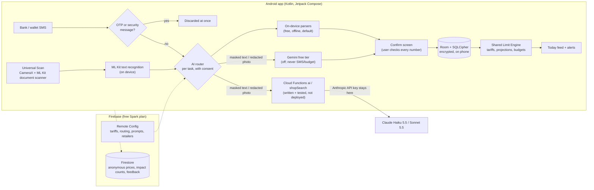

# Easy Life · آسان زندگی

**An Android app that helps Pakistani households stay under the 200-unit electricity limit, pay bills on time, see where their money goes, read English paperwork in Urdu, and shop for less, in Urdu or English.**

Built for ILAP 2027 by a student of Beaconhouse BSS JTC, Lahore. Free, works offline, and keeps money data on the phone.

**[⬇ Download the latest APK](https://github.com/hashimfowad2010/easy-life/releases/latest/download/EasyLife.apk)** · [All releases](https://github.com/hashimfowad2010/easy-life/releases)

| Today (demo data) | Bijli Guard | اردو میں |
|---|---|---|
|  |  |  |

*Screenshots are taken automatically by the emulator test in CI, using the app's fictional demo family.*

---

## What it does

| Module | The problem | What Easy Life does |
|---|---|---|
| ⚡ **Bijli Guard** (Limits) | Households that use 200 units or less a month for 6 months are "protected" and pay a much lower rate. One month over 200 loses that for 6 months. | Reads the bill and meter photos, projects the month's units, warns early ("At this pace you'll reach 234 units by 9 Nov. Keep to 5.6 units a day"), shows the money at stake, flags late meter readings, and suggests appliance changes. |
| 🧾 **Bills** | Late fees and forgotten due dates. | Scan any utility/school bill, confirm the numbers, get reminders before the due date, see "Pay by 24 Oct to save Rs 538". |
| 💰 **Budget** | People don't know where money goes, and banking apps aren't in Urdu. | Reads bank and wallet SMS on the phone (never bank passwords; OTPs are discarded at once), categories, budgets, exclusions (e.g. money sent to family), receipts. |
| 📖 **Urdu Helper** | School circulars, prescriptions and notices arrive in English. | Scan, translate to simple Urdu, read aloud, find dates, amounts and to-dos; share text from WhatsApp straight in. |
| 🛒 **Smart Shopping** | Prices differ a lot between shops. | Lists in Roman Urdu ("2 kg cheeni, 1 dozen anday"), community prices from receipts, unit-price comparison, best single shop or best split, budget check. |

Everything starts with **Universal Scan** (one camera button) and a shared **Limit Engine**, and shows up on a single **Today** feed.

## Install on a phone

1. On the phone, open the [latest release](https://github.com/hashimfowad2010/easy-life/releases/latest) and tap **EasyLife.apk**.
2. When Android asks, allow your browser (or Files app) to **install unknown apps**.
3. Tap **Install**. Updates install over the old version and keep your data (every release is signed with the same key).

Android 8.0 or newer. About 40 MB. The Urdu translation model (about 30 MB) is downloaded once, on Wi-Fi, when you first need it.

## Privacy, in plain words

- **No bank passwords, PINs, OTPs, CVVs, full card or account numbers, or IBANs. Ever.** Only a bank's name and, if you want, the last 4 digits.
- OTP and security messages are thrown away the moment they arrive, never stored or sent.
- Money data stays **on the phone** in an encrypted database (SQLCipher, key protected by the Android Keystore). It is never synced.
- Before any text goes to a cloud AI, account, card, CNIC, IBAN and phone numbers are replaced with `[MASKED]`; photos have those areas blacked out.
- Cloud AI is **off by default** and only used with your consent. Bank SMS and budget data are never sent to a free AI tier.
- Every result says where it came from: "Read on your phone", "Smart AI (Gemini)", "Smart AI (Claude)" or "Demo data". Estimates say "Estimated" and the tariff date. Prices are never "guaranteed cheapest".
- You can export everything, delete everything, turn modules off, and switch Smart AI off.

Full notice in English and Urdu: [PRIVACY.md](PRIVACY.md) (also inside the app).

## How it works



- **On-device first.** Bills, meter photos, receipts, SMS, lists and documents are read by rule-based parsers on the phone, so the app is free and works offline. Cloud AI providers are optional plug-ins behind Remote Config switches.
- **One prompt source.** Cloud prompts and JSON schemas live in [`ai-prompts/`](ai-prompts/) and are bundled into both the app and the Cloud Functions.
- **Tariffs from Remote Config.** Slab rates can be updated without an app update; the app ships with defaults and always shows the tariff date.

Code map: see [CLAUDE.md](CLAUDE.md) (conventions) and [PLAN.md](PLAN.md) (decisions). Progress per phase: [PROGRESS.md](PROGRESS.md). Manual test list: [QA.md](QA.md).

## Build, CI and releases

There is no local build step: GitHub Actions builds everything.

- **CI** (`.github/workflows/ci.yml`, every push): Android unit tests, debug APK, lint; Cloud Functions build + tests; Firestore security rules tested on the Firestore emulator; Remote Config template check.
- **Emulator smoke test** (`smoke.yml`): installs the app on an Android 14 emulator and walks every main screen in English and Urdu, saving screenshots.
- **Release** (`release.yml`): push a tag `vA.B.C` and CI builds a signed APK, verifies the signature, and publishes a GitHub Release with `EasyLife.apk` and notes from `release-notes/vA.B.C.md`.
- **Deploy Firebase** (`deploy-firebase.yml`, manual): Firestore rules, Remote Config, or (after funding) Cloud Functions.

Firebase is optional for building: without the `GOOGLE_SERVICES_JSON` secret the app builds with online features off and says so in Settings.

## Switching on Smart AI (Claude)

Everything is built and tested; nothing costs money until these steps are done.

1. **Firebase Blaze plan + budget alert.** In the Firebase console click **Upgrade** next to "Spark plan" (bottom of the left menu) and choose **Blaze**. Then in the Google Cloud console open **Billing → Budgets & alerts → Create budget** (e.g. USD 30 a month, alerts at 50 %, 90 % and 100 %).
2. **Anthropic API key.** At [platform.claude.com](https://platform.claude.com) create an API key (and set a monthly spend limit there too). Then, on a computer with the Firebase CLI:
   ```bash
   npx firebase-tools@15.33.0 functions:secrets:set ANTHROPIC_API_KEY --project YOUR_PROJECT_ID
   ```
3. **Deploy the functions.** GitHub → Actions → **Deploy Firebase (manual)** → Run workflow → target `functions`, tick `claude_enabled`, set `monthly_budget_usd`. (Needs the `FIREBASE_SERVICE_ACCOUNT` and `FIREBASE_PROJECT_ID` secrets.)
4. **Turn it on in the app.** Firebase console → Remote Config → set `claude_enabled` = `true` → Publish. `ai_routing` already lists `claude` first for photo and explanation tasks; users still choose Smart AI in Settings → Smart AI.

The functions stop by themselves at 30 calls per user per day, 3,000 per day overall, and the monthly USD budget.

### What it costs

Claude API list prices (checked 23 Oct 2026): **Haiku 5.5** USD 0.10 / 0.50 and **Sonnet 5.5** USD 2 / 10 per million input / output tokens; **web search** USD 10 per 1,000 searches. Token counts below are estimates for this app's prompts (a 1600 px photo is about 2,450 tokens; the shared system prompt is cached). Run `npm run cost` in `firebase/functions` to recompute.

| Task | Model | Per use | ≈ PKR |
|---|---|---|---|
| Bill photo scan | Sonnet 5.5 | $0.021 | Rs 5.9 |
| Meter photo | Sonnet 5.5 | $0.012 | Rs 3.2 |
| Receipt photo | Sonnet 5.5 | $0.021 | Rs 5.9 |
| Explain a document in simple Urdu | Sonnet 5.5 | $0.031 | Rs 8.7 |
| Bank SMS the phone couldn't read | Haiku 5.5 | $0.0002 | Rs 0.05 |
| Translate a page | Haiku 5.5 | $0.0009 | Rs 0.25 |
| Weekly summary | Haiku 5.5 | $0.0004 | Rs 0.11 |
| Online prices for a list (≤ 8 items, shared 24 h cache) | Sonnet 5.5 + web search | $0.13 | Rs 36 |

**A typical family** (3 bills, 6 meter photos, 4 receipts, 3 documents, 10 SMS, 4 translations, 4 summaries and 1 price search a month): **about $0.45 (Rs 125) a month. 100 families: about $45 (Rs 12,500) a month.** PKR at 280 per USD. Most work still runs on the phone for free; Smart AI is for accuracy on difficult photos and simple-Urdu explanations.

## Collecting pilot results (for ILAP)

Each phone can make its own report: **Settings → Help the project → ILAP impact report** (CSV or a one-page PDF). To combine all pilot phones (only those that turned on "Share anonymous counts", plus all feedback), run this on your own computer with the service-account key (never in GitHub Actions, whose files are public on a public repo):

```bash
cd firebase/functions && npm ci && node scripts/impact-aggregate.mjs --key path/to/service-account.json --out ../../impact-results
```

It writes `impact-by-pilot.csv` (events per pilot code, number of phones), `feedback-by-pilot.csv` and `feedback-comments.csv`. The `impact-results/` folder is git-ignored.

## Limitations (honest)

- On-device parsers were built and tested on **fictional** bills and SMS. Real bills vary; Parser Lab (Settings → tap version 7 times) is there to tune them with real samples kept off GitHub (see [test-data.README.md](test-data.README.md)).
- Meter photos need good light; low-confidence digits are always highlighted for the user to check.
- Bill estimates use published slab rates plus typical taxes and are labelled "Estimated" with the tariff date; the real bill can differ.
- Reading SMS needs the SMS permission, which Google Play allows only for default SMS apps. This APK is installed directly; a Play Store version would use notification access or statement import instead (both already in the app).
- Community prices are only as good as the receipts people share; outliers are removed with a robust median filter. Online price search needs Smart AI (after funding).
- Urdu text-to-speech needs an Urdu voice on the phone; the app explains how to install one and falls back to showing text.

## Scaling plan

1. **Play Store:** switch SMS reading to notification access and PDF/CSV statement import (built), keep the direct APK for pilots.
2. **Open banking:** when Pakistan's open-banking framework goes live, add read-only bank connections with the same on-phone storage.
3. **More cities and retailers:** retailer list, search URLs and city list come from Remote Config; community prices grow with every shared receipt.
4. **Tariff updates:** NEPRA changes go out through Remote Config the same day, with the date shown in the app.
5. **More languages:** strings are typed bilingual tables; adding Punjabi, Sindhi or Pashto means adding one column and a font.
6. **Smart AI at scale:** per-task model routing (cheap Haiku for text, Sonnet for photos), shared price cache, per-user limits and a monthly budget cap keep cost per family low.

## Repository layout

```
app/                      Android app (one Gradle module, package-by-feature)
ai-prompts/               shared cloud prompts + JSON schemas (versioned)
firebase/                 Firestore rules, Remote Config template, Cloud Functions (TypeScript)
release-notes/            notes for each GitHub Release
.github/workflows/        CI, emulator smoke test, release, manual Firebase deploy
```

