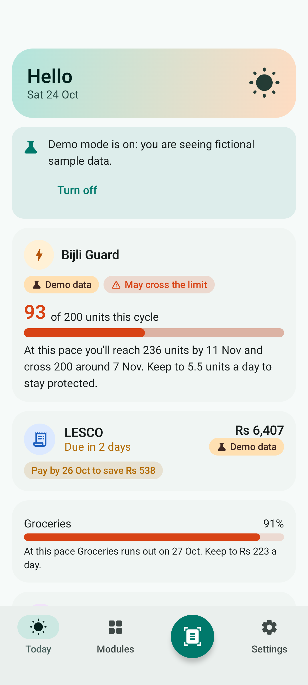
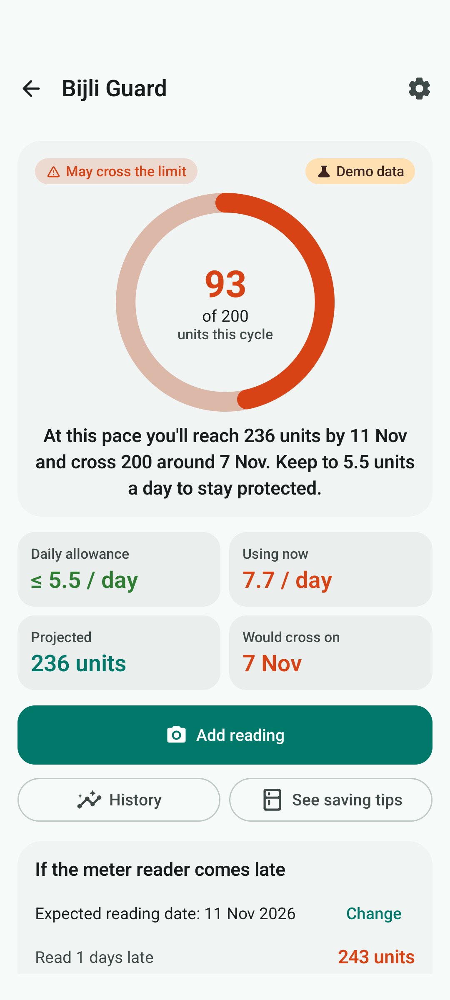
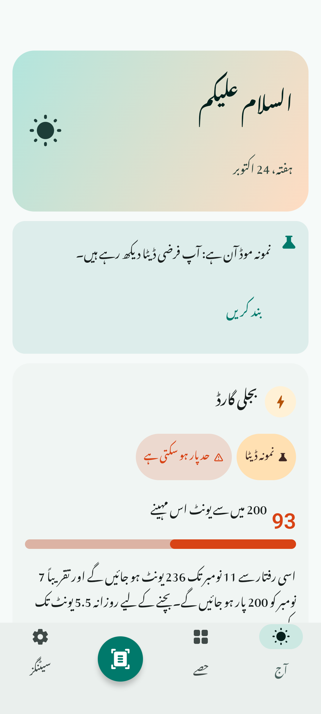
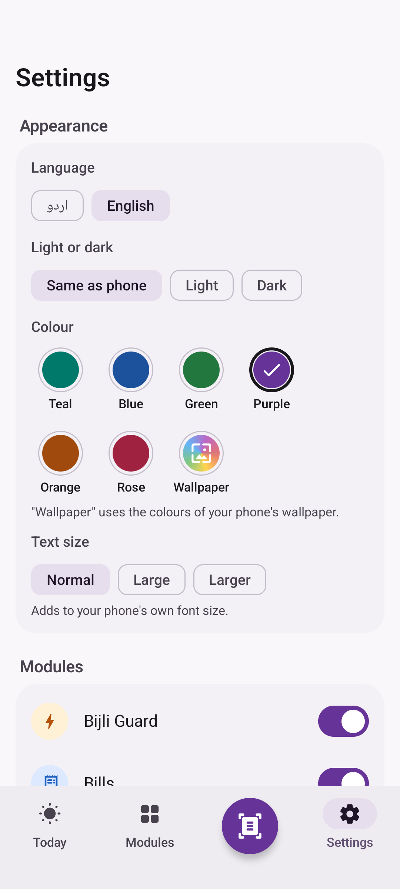
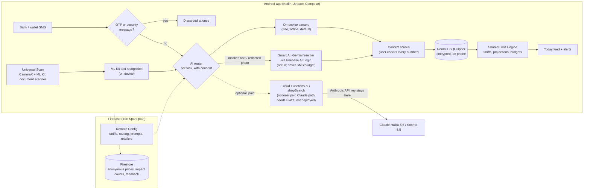

# Easy Life · آسان زندگی

**An Android app that helps Pakistani households stay under the 200-unit electricity limit, pay bills on time, see where their money goes, read English paperwork in Urdu, and shop for less, in Urdu or English.**

Built for ILAP 2027 by a student of Beaconhouse BSS JTC, Lahore. Free, works offline, and keeps money data on the phone. The optional Smart AI uses Google Gemini's free tier, so nothing needs a paid plan.

**[⬇ Download the latest APK](https://github.com/hashimfowad2010/easy-life/releases/latest/download/EasyLife.apk)** · [All releases](https://github.com/hashimfowad2010/easy-life/releases)

| Today (demo data) | Bijli Guard | اردو میں | Your colours |
|---|---|---|---|
|  |  |  |  |

*Screenshots are taken automatically by the emulator test in CI, using the app's fictional demo family.*

---

## What it does

| Module | The problem | What Easy Life does |
|---|---|---|---|
| ⚡ **Bijli Guard** (Limits) | Households that use 200 units or less a month for 6 months are "protected" and pay a much lower rate. One month over 200 loses that for 6 months. | Reads the bill and meter photos, projects the month's units, warns early ("At this pace you'll reach 234 units by 9 Nov. Keep to 5.6 units a day"), shows the money at stake, flags late meter readings, and suggests appliance changes. |
| 🧾 **Bills** | Late fees and forgotten due dates. | Scan any utility/school bill, confirm the numbers, get reminders before the due date, see "Pay by 24 Oct to save Rs 538". |
| 💰 **Budget** | People don't know where money goes, and banking apps aren't in Urdu. | Reads bank and wallet SMS on the phone (never bank passwords; OTPs are discarded at once), categories, budgets, exclusions (e.g. money sent to family), receipts. |
| 📖 **Urdu Helper** | School circulars, prescriptions and notices arrive in English. | Scan, translate to simple Urdu, read aloud, find dates, amounts and to-dos; share text from WhatsApp straight in. |
| 🛒 **Smart Shopping** | Prices differ a lot between shops. | Lists in Roman Urdu ("2 kg cheeni, 1 dozen anday"), community prices from receipts, unit-price comparison, best single shop or best split, budget check. |

Everything starts with **Universal Scan** (one camera button) and a shared **Limit Engine**, and shows up on a single **Today** feed.

## Install on a phone

1. On the phone, open the [latest release](https://github.com/hashimfowad2010/easy-life/releases/latest) and tap **EasyLife.apk**.
2. When Android asks, allow your browser (or Files app) to **install unknown apps**.
3. Tap **Install**. Updates install over the old version and keep your data (every release is signed with the same key).

Android 8.0 or newer. The download is about 30 MB (about 60 MB once installed). The Urdu translation model (about 30 MB) is downloaded once, on Wi-Fi, when you first need it.

**Which APK?** Use **`EasyLife.apk`**. It does not ask to read SMS or notifications, because Google Play Protect blocks apps installed from the internet that do ("App blocked to protect your device"). Bank SMS go into Budget by **sharing** them (long-press the message → Share → Easy Life) or **pasting** them (Budget → Banks and wallets → "Add bank messages"). `EasyLife-with-SMS.apk` is the same app plus automatic SMS reading, for phones where Play Protect allows it.

## Privacy, in plain words

- **No bank passwords, PINs, OTPs, CVVs, full card or account numbers, or IBANs. Ever.** Only a bank's name and, if you want, the last 4 digits.
- OTP and security messages are thrown away the moment they arrive, never stored or sent.
- Money data stays **on the phone** in an encrypted database (SQLCipher, key protected by the Android Keystore). It is never synced.
- Before anything goes to Smart AI, account, card, CNIC, IBAN, phone and reference numbers, names and addresses are replaced with `[MASKED]`; photos have those areas blacked out.
- Smart AI (Google Gemini, free) is **off until you turn it on**, for adults (18+). On the free tier Google may use and review what is sent, and the app says so first. Bank SMS and budget data are never sent.
- Every result says where it came from: "Read on your phone", "Smart AI (Gemini)", "Smart AI (Claude)" or "Demo data". Estimates say "Estimated" and the tariff date. Prices are never "guaranteed cheapest".
- You can export everything, delete everything, turn modules off, and switch Smart AI off.

Full notice in English and Urdu: [PRIVACY.md](PRIVACY.md) (also inside the app).

## How it works



- **On-device first.** Bills, meter photos, receipts, SMS, lists and documents are read by rule-based parsers on the phone, so the app is free and works offline. Smart AI (Gemini, free) is an opt-in plug-in for hard photos and simple-Urdu explanations; the router falls back to the phone whenever it is off, offline or out of quota.
- **One prompt source.** Cloud prompts and JSON schemas live in [`ai-prompts/`](ai-prompts/) and are bundled into both the app and the Cloud Functions.
- **Tariffs from Remote Config.** Slab rates can be updated without an app update; the app ships with defaults and always shows the tariff date.

Code map: see [CLAUDE.md](CLAUDE.md) (conventions) and [PLAN.md](PLAN.md) (decisions). Progress per phase: [PROGRESS.md](PROGRESS.md). Manual test list: [QA.md](QA.md).

## Build, CI and releases

There is no local build step: GitHub Actions builds everything.

- **CI** (`.github/workflows/ci.yml`, every push): Android unit tests, debug APK, lint; Cloud Functions build + tests; Firestore security rules tested on the Firestore emulator; Remote Config template check.
- **Emulator smoke test** (`smoke.yml`): installs the app on an Android 14 emulator and walks every main screen in English and Urdu, saving screenshots.
- **Release** (`release.yml`): push a tag `vA.B.C` and CI builds a signed APK, verifies the signature, and publishes a GitHub Release with `EasyLife.apk` and notes from `release-notes/vA.B.C.md`.
- **Deploy Firebase** (`deploy-firebase.yml`, manual): Firestore rules, Remote Config, or the optional paid Cloud Functions.

Firebase is optional for building: without the `GOOGLE_SERVICES_JSON` secret the app builds with online features off and says so in Settings.

### Connecting Firebase (free Spark plan)

1. [Firebase console](https://console.firebase.google.com) → **Add project** (Google Analytics can stay off).
2. **Add app → Android**, package `com.easylife.app`; then add a second Android app `com.easylife.app.debug` (CI's debug builds). Download `google-services.json` after adding the second app (it then contains both).
3. **Authentication → Get started → Sign-in method → Anonymous → Enable.**
4. **Firestore Database → Create database** (location `asia-south1`, production mode) → **Rules** tab → paste [`firebase/firestore.rules`](firebase/firestore.rules) → **Publish**.
5. **AI Logic → Get started → Gemini Developer API** (keep the free Spark plan; don't link billing). This is Smart AI.
6. **Crashlytics → Get started.** Remote Config needs nothing: the app ships with defaults, and the deploy workflow uploads [`firebase/remoteconfig.template.json`](firebase/remoteconfig.template.json).
7. GitHub → **Settings → Secrets and variables → Actions → New repository secret**: `GOOGLE_SERVICES_JSON` = the whole file's text. The next build has online features on.
8. Optional, for the deploy workflow and pilot results: **Project settings → Service accounts → Generate new private key**, then secrets `FIREBASE_SERVICE_ACCOUNT` (the key file's text) and `FIREBASE_PROJECT_ID`. Keep the key file private; it is git-ignored by name (`service-account*.json`).

## Smart AI with Google Gemini (free)

Smart AI reads difficult photos better (bills, meter readings, receipts) and explains papers in simple Urdu. It is **Google Gemini through Firebase AI Logic on the free tier**: the Firebase project stays on the no-cost Spark plan with no billing account, so it can never charge anything, and there is no API key in the app.

- **Opt-in, adults only.** Each person turns it on in **Settings → Smart AI** after reading what is sent, and confirms they are 18 or older (Google's terms for apps built on the Gemini API).
- **What goes to Gemini:** bill, meter and receipt photos and "explain this paper" go to Gemini first. Translation, shopping lists and photo-type detection use it only when the phone can't. Bank SMS, budgets and the weekly summary **never** leave the phone.
- **Hidden first:** account, card, CNIC, IBAN, phone and reference numbers, names and addresses (masked in text, blacked out in photos). On the free tier Google may use what is sent to improve its products and people may review it; the app says this before anyone turns it on.
- **Shared free quota:** Gemini's free limits are per Firebase project (all phones together) and reset daily at midnight Pacific time. Each phone gets at most 15 Smart AI reads a day (`gemini_daily_limit` in Remote Config). When the quota is used up, or offline, the app quietly reads on the phone instead.
- **Honest labels:** every result shows "Smart AI (Gemini)" and goes through the confirm screen.

**To switch it on:** connect Firebase (above), including step 5 (**AI Logic → Gemini Developer API**). The model is `gemini-3.8-flash` (Remote Config `gemini_model`). Your project's free limits are listed at [aistudio.google.com/rate-limit](https://aistudio.google.com/rate-limit); if that model shows no free quota, set `gemini_model` to one that does (for example `gemini-3.5-flash-lite`) in Remote Config and publish.

### Optional later: Claude (paid, not needed)

The repository also holds a paid alternative that is **not used and not needed**: Cloud Functions `ai` and `shopSearch` calling Claude (Haiku 5.5 / Sonnet 5.5) with automatic online price search. They are tested in CI on every push but never deployed, because they need the Blaze plan and an Anthropic API key. Rough cost if it were ever switched on: about Rs 6 per bill scan, about USD 45 a month for 100 families.

<details>
<summary>Steps and cost table for the paid Claude path</summary>


Everything is built and tested; nothing costs money until these steps are done.

1. **Firebase Blaze plan + budget alert.** In the Firebase console click **Upgrade** next to "Spark plan" (bottom of the left menu) and choose **Blaze**. Then in the Google Cloud console open **Billing → Budgets & alerts → Create budget** (e.g. USD 30 a month, alerts at 50 %, 90 % and 100 %).
2. **Anthropic API key.** At [platform.claude.com](https://platform.claude.com) create an API key (and set a monthly spend limit there too). Then, on a computer with the Firebase CLI:
   ```bash
   npx firebase-tools@15.33.0 functions:secrets:set ANTHROPIC_API_KEY --project YOUR_PROJECT_ID
   ```
3. **Deploy the functions.** GitHub → Actions → **Deploy Firebase (manual)** → Run workflow → target `functions`, tick `claude_enabled`, set `monthly_budget_usd`. (Needs the `FIREBASE_SERVICE_ACCOUNT` and `FIREBASE_PROJECT_ID` secrets.)
4. **Turn it on in the app.** Firebase console → Remote Config → set `claude_enabled` = `true`, add `"claude"` before `"gemini_free"` in `ai_routing` for the tasks you want → Publish. Users still choose Smart AI in Settings → Smart AI.

The functions stop by themselves at 30 calls per user per day, 3,000 per day overall, and the monthly USD budget.

#### What it costs

Claude API list prices (checked 23 Oct 2026): **Haiku 5.5** USD 0.10 / 0.50 and **Sonnet 5.5** USD 2 / 10 per million input / output tokens; **web search** USD 10 per 1,000 searches. Token counts below are estimates for this app's prompts (a 1600 px photo is about 2,450 tokens; the shared system prompt is cached). Run `npm run cost` in `firebase/functions` to recompute.

| Task | Model | Per use | ≈ PKR |
|---|---|---|---|
| Bill photo scan | Sonnet 5.5 | $0.021 | Rs 5.9 |
| Meter photo | Sonnet 5.5 | $0.012 | Rs 3.2 |
| Receipt photo | Sonnet 5.5 | $0.021 | Rs 5.9 |
| Explain a document in simple Urdu | Sonnet 5.5 | $0.031 | Rs 8.7 |
| Bank SMS the phone couldn't read | Haiku 5.5 | $0.0002 | Rs 0.05 |
| Translate a page | Haiku 5.5 | $0.0009 | Rs 0.25 |
| Weekly summary | Haiku 5.5 | $0.0004 | Rs 0.11 |
| Online prices for a list (≤ 8 items, shared 24 h cache) | Sonnet 5.5 + web search | $0.13 | Rs 36 |

**A typical family** (3 bills, 6 meter photos, 4 receipts, 3 documents, 10 SMS, 4 translations, 4 summaries and 1 price search a month): **about $0.45 (Rs 125) a month. 100 families: about $45 (Rs 12,500) a month.** PKR at 280 per USD. Most work still runs on the phone for free; Smart AI is for accuracy on difficult photos and simple-Urdu explanations.

</details>

## Collecting pilot results (for ILAP)

Each phone can make its own report: **Settings → Help the project → Impact report** (CSV or a one-page PDF). To combine all pilot phones (only those that turned on "Share anonymous counts", plus all feedback), run this on your own computer with the service-account key (never in GitHub Actions, whose files are public on a public repo):

```bash
cd firebase/functions && npm ci && node scripts/impact-aggregate.mjs --key path/to/service-account.json --out ../../impact-results
```

It writes `impact-by-pilot.csv` (events per pilot code, number of phones), `feedback-by-pilot.csv` and `feedback-comments.csv`. The `impact-results/` folder is git-ignored.

## Limitations (honest)

- On-device parsers were built and tested on **fictional** bills and SMS. Real bills vary; Parser Lab (Settings → tap version 7 times) is there to tune them with real samples kept off GitHub (see [test-data.README.md](test-data.README.md)).
- Meter photos need good light; low-confidence digits are always highlighted for the user to check.
- Bill estimates use published slab rates plus typical taxes and are labelled "Estimated" with the tariff date; the real bill can differ.
- **Automatic SMS reading is not in the main APK.** Google Play Protect blocks internet-installed apps that ask to read SMS or notifications, and Google Play allows SMS access only for default SMS apps. So `EasyLife.apk` takes bank SMS by share or paste (or statement import); `EasyLife-with-SMS.apk` reads them automatically where the phone allows it.
- Community prices are only as good as the receipts people share; outliers are removed with a robust median filter. There is no automatic online price search on the free plan: Google's terms don't allow storing or editing search-grounded answers, so online prices come from the retailer search buttons.
- The free Gemini quota is shared by every phone in the Firebase project. When it runs out (it resets daily) or there is no internet, Smart AI quietly falls back to reading on the phone.
- Urdu text-to-speech needs an Urdu voice on the phone; the app explains how to install one and falls back to showing text.

## Scaling plan

1. **Play Store:** publish the standard build (share/paste and statement import, no SMS permission) with a verified developer account; keep the direct APKs for pilots.
2. **Open banking:** when Pakistan's open-banking framework goes live, add read-only bank connections with the same on-phone storage.
3. **More cities and retailers:** retailer list, search URLs and city list come from Remote Config; community prices grow with every shared receipt.
4. **Tariff updates:** NEPRA changes go out through Remote Config the same day, with the date shown in the app.
5. **More languages:** strings are typed bilingual tables; adding Punjabi, Sindhi or Pashto means adding one column and a font.
6. **Smart AI at scale:** the free Gemini tier is right for pilots. For many families, a paid tier gives more quota and keeps data out of model training: Gemini's paid tier (link billing) or the Claude path already in this repo, with per-user limits and a monthly budget cap.

## Repository layout

```
app/                      Android app (one Gradle module, package-by-feature)
ai-prompts/               shared cloud prompts + JSON schemas (versioned)
firebase/                 Firestore rules, Remote Config template, Cloud Functions (TypeScript)
release-notes/            notes for each GitHub Release
.github/workflows/        CI, emulator smoke test, release, manual Firebase deploy
```

